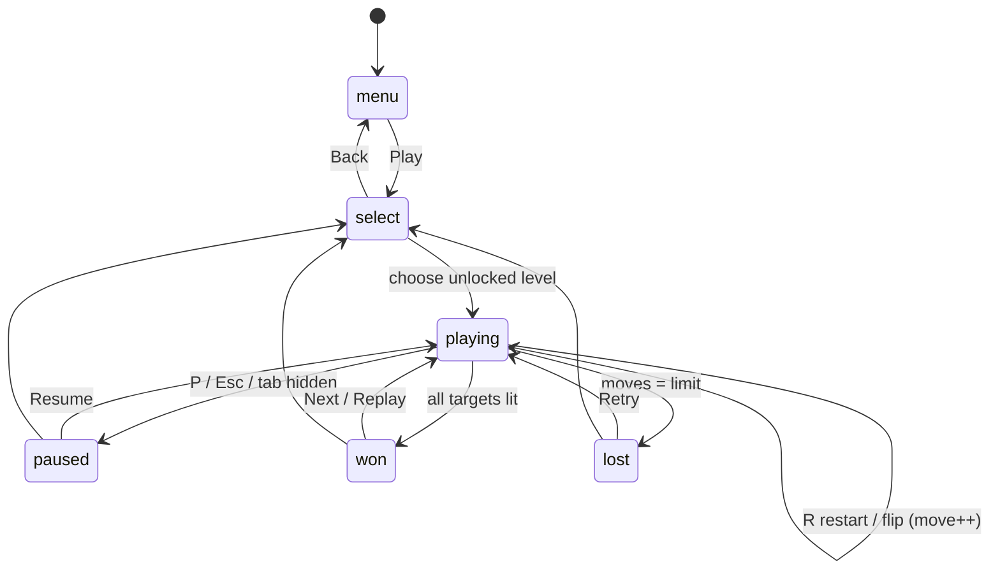

# Task 3: State, Progression, Persistence

**Progression:** 9 levels (5x5 to 8x8) with more mirrors, walls, splitters, targets. Level N+1 unlocks when level N has ≥1 star.
**Scoring:** 3★ moves ≤ par · 2★ ≤ par+2 · 1★ otherwise. Par = fewest flips from the start layout to any solution (computed by the level generator's solver, so every level is provably solvable).
**Persisted (`localStorage lumen-v1`):** mute, reduced motion, best stars per level. Nothing else.

## Edge-case checklist
- [ ] Illegal transitions (menu → won) ignored
- [ ] Locked level button is disabled and not focusable
- [ ] Flip on empty/fixed/wall cell does nothing, no move counted
- [ ] Undo at 0 moves does nothing; undo never goes below 0 moves
- [ ] Win on the exact last allowed move → won, not lost
- [ ] Restart resets moves, undo stack, particles
- [ ] Tab hidden → paused; resume continues
- [ ] localStorage blocked → game still plays
- [ ] Reload keeps stars, unlocks, mute, reduced motion
